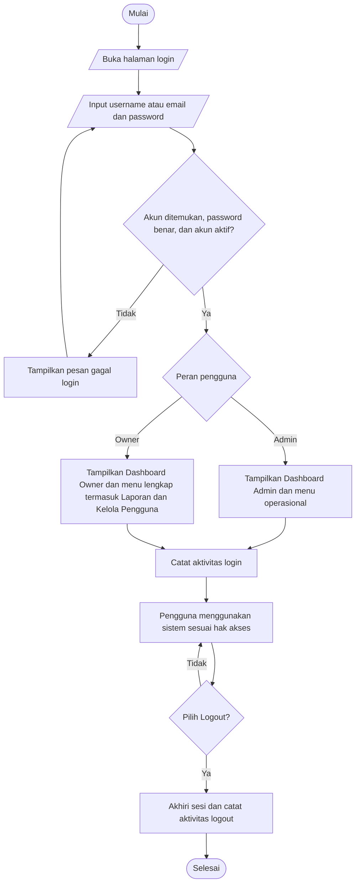
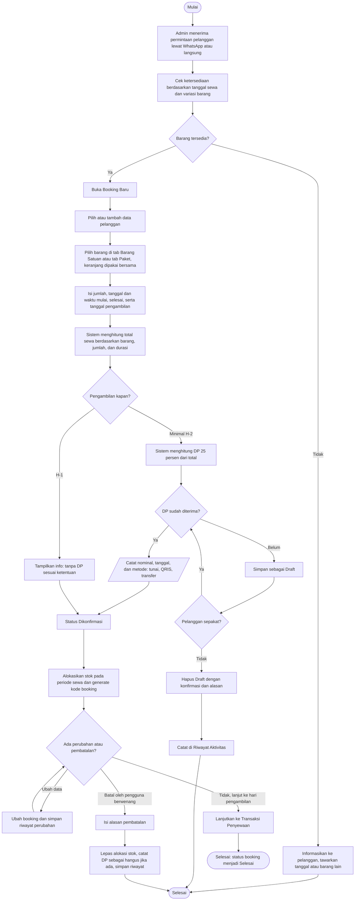
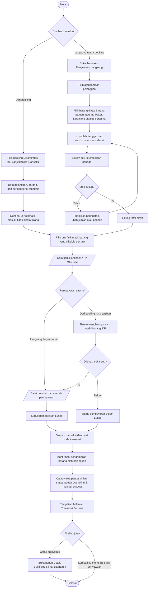
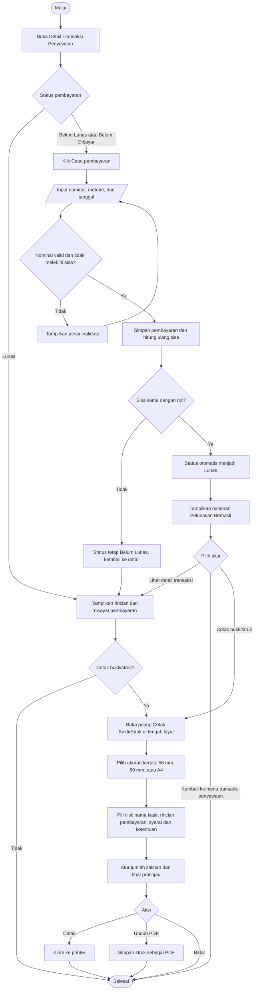
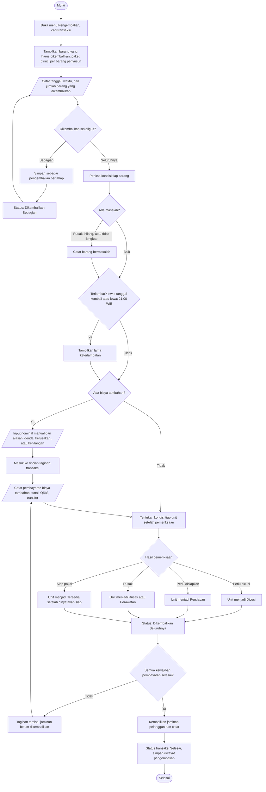
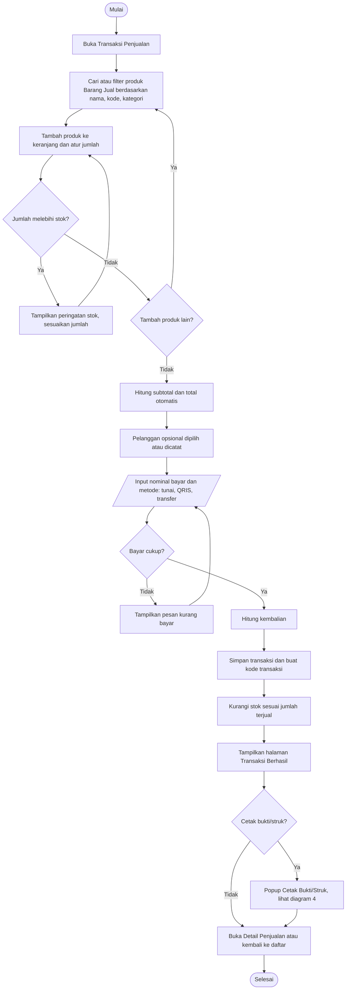
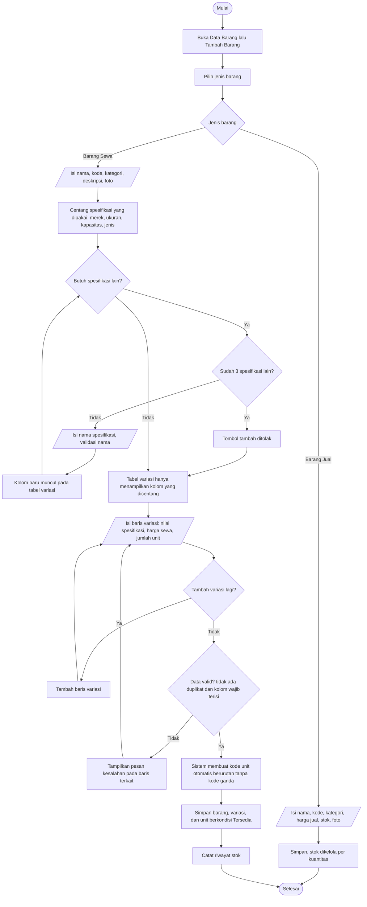
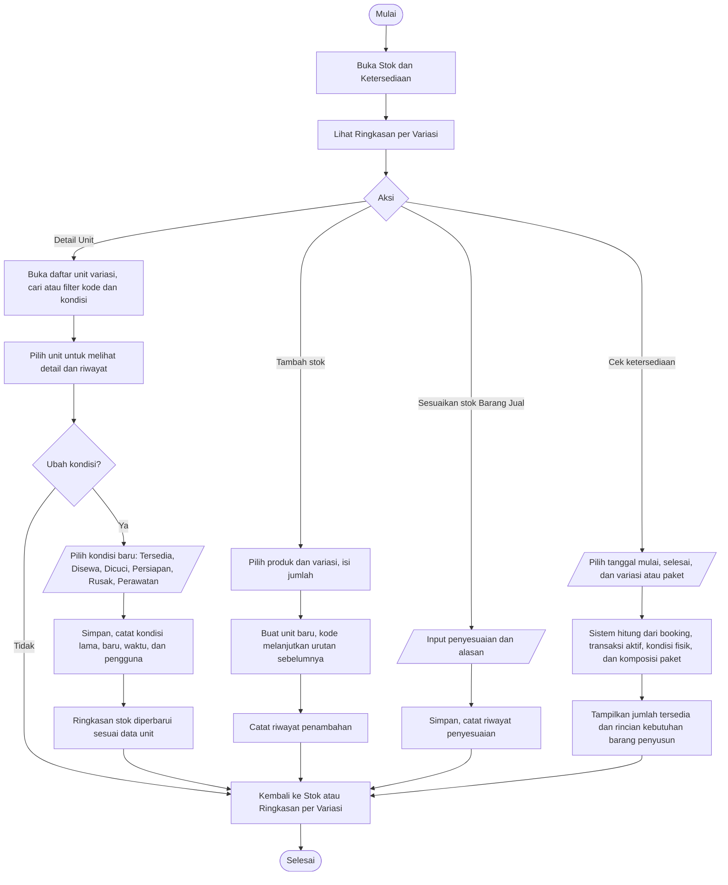
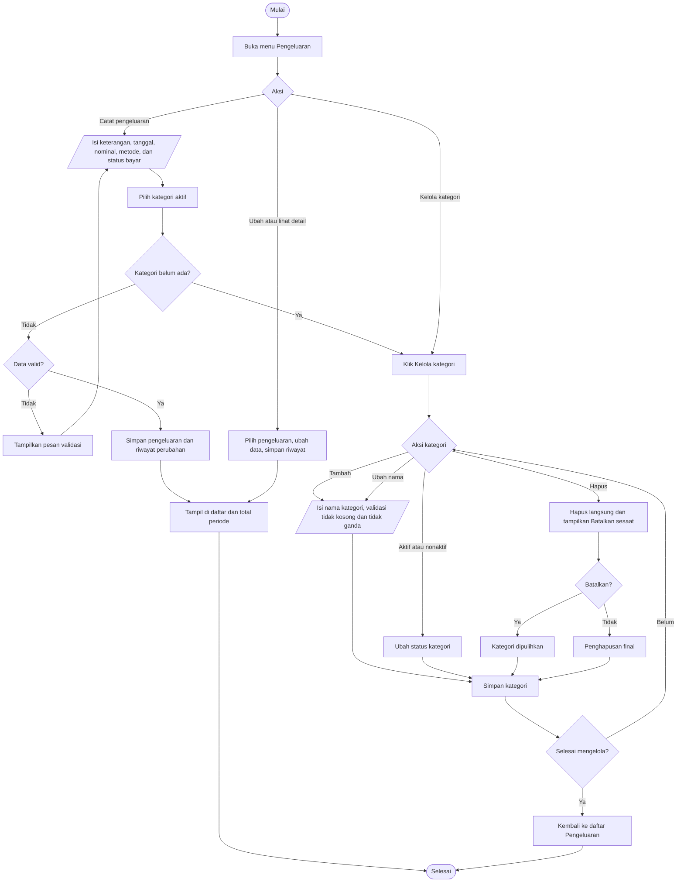
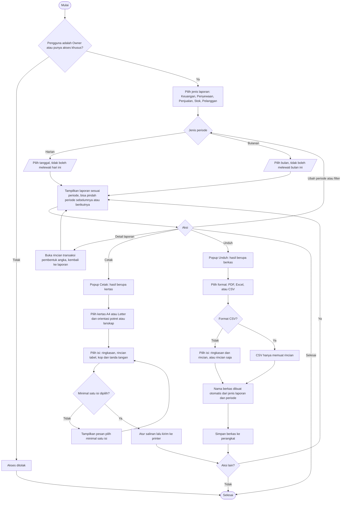

# Activity Diagram – Summit Rental & Store

Diagram aktivitas dalam teks (Mermaid, otomatis tampil di GitHub, GitLab, dan VS Code).
Notasi: `([ ])` awal/akhir · `[ ]` aktivitas · `{ }` keputusan · `[/ /]` input/keluaran.

Daftar diagram:
1. Login, Logout, dan Hak Akses
2. Booking
3. Transaksi Penyewaan (dari booking atau langsung)
4. Pelunasan dan Cetak Bukti/Struk
5. Pengembalian Barang
6. Transaksi Penjualan
7. Tambah Barang Sewa (variasi dan unit)
8. Pengelolaan Kondisi Unit dan Stok
9. Pengeluaran dan Kelola Kategori
10. Laporan (periode, cetak, unduh)

---

## 1. Login, Logout, dan Hak Akses

---

## 2. Booking

---

## 3. Transaksi Penyewaan (dari booking atau langsung)

---

## 4. Pelunasan dan Cetak Bukti/Struk

---

## 5. Pengembalian Barang

---

## 6. Transaksi Penjualan

---

## 7. Tambah Barang Sewa (variasi dan unit)

---

## 8. Pengelolaan Kondisi Unit dan Stok

---

## 9. Pengeluaran dan Kelola Kategori

Menu Pengeluaran sama untuk Admin dan Owner.

---

## 10. Laporan (periode, cetak, unduh)

