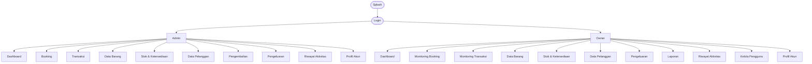

# Sitemap Summit Rental & Store

Struktur halaman sistem berdasarkan menu navigasi dan tautan antar-halaman pada desain.
Dua peran: **Admin** dan **Owner**. Keduanya dimulai dari `Splash → Login`.

```
Splash
└── Login
    ├── Admin (Admin Toko)
    └── Owner (Pemilik Toko)
```

---

## 1. Admin

### Struktur

```
Admin
├── Dashboard
│   └── Ringkasan Hari Ini
├── Booking
│   ├── Daftar Booking
│   ├── Booking Baru
│   ├── Cek Ketersediaan
│   └── Detail Booking
├── Transaksi
│   ├── Transaksi Penyewaan
│   │   ├── Sewa Baru
│   │   └── Detail Transaksi
│   │       ├── Form Bayar (Pelunasan)
│   │       │   └── Pelunasan Berhasil
│   │       └── Form Pengembalian
│   └── Transaksi Penjualan
│       ├── Penjualan Baru
│       └── Detail Penjualan
├── Data Barang
│   ├── Semua Barang
│   │   ├── Detail Barang
│   │   │   └── Detail Unit
│   │   └── Form Barang (Sewa / Jual)
│   ├── Kategori Barang
│   │   └── Form Kategori
│   └── Paket Penyewaan
│       └── Form Paket
├── Stok & Ketersediaan
│   ├── Stok Barang Sewa
│   │   └── Detail Unit
│   └── Stok Barang Jual
├── Data Pelanggan
│   └── Detail Pelanggan
│       └── Detail Transaksi
├── Pengembalian
│   └── Form Pengembalian
│       ├── Form Biaya (Biaya Tambahan)
│       └── Form Bayar (Pembayaran)
├── Pengeluaran
│   ├── Form Pengeluaran
│   └── Kategori Biaya
├── Riwayat Aktivitas
│   └── Detail Riwayat
└── Profil Akun
    └── Keluar → Login
```

### Tabel halaman

| Menu | Halaman | Keterangan |
|---|---|---|
| Dashboard | Dashboard Admin | Ringkasan operasional dan pintasan |
| Booking | Daftar Booking, Booking Baru, Cek Ketersediaan, Detail Booking | |
| Transaksi → Penyewaan | Daftar Transaksi Penyewaan, Sewa Baru, Detail Transaksi, Form Bayar, Pelunasan Berhasil, Cetak Bukti | Pelunasan dari Detail Transaksi |
| Transaksi → Penjualan | Daftar Transaksi Penjualan, Penjualan Baru, Detail Penjualan | |
| Data Barang | Semua Barang, Detail Barang, Detail Unit, Form Barang, Kategori Barang, Form Kategori, Paket Penyewaan, Form Paket | |
| Stok & Ketersediaan | Stok Barang Sewa, Stok Barang Jual, Detail Unit | |
| Data Pelanggan | Daftar Pelanggan, Detail Pelanggan | |
| Pengembalian | Daftar Pengembalian, Form Pengembalian, Form Biaya, Form Bayar | |
| Pengeluaran | Daftar Pengeluaran, Form Pengeluaran, Kategori Biaya | |
| Riwayat Aktivitas | Daftar Riwayat, Detail Riwayat | |
| Profil Akun | Profil Akun | Keluar ke Login |

---

## 2. Owner

### Struktur

```
Owner
├── Dashboard
│   └── Ringkasan Bisnis
├── Monitoring Booking
│   ├── Daftar Booking
│   └── Detail Booking
├── Monitoring Transaksi
│   ├── Transaksi Penyewaan
│   │   └── Detail Transaksi
│   └── Transaksi Penjualan
│       └── Detail Penjualan
├── Data Barang
│   ├── Semua Barang
│   │   ├── Detail Barang
│   │   │   └── Detail Unit
│   │   └── Form Barang
│   ├── Kategori Barang
│   │   └── Form Kategori
│   └── Paket Penyewaan
│       └── Form Paket
├── Stok & Ketersediaan
│   ├── Stok Barang Sewa
│   │   └── Detail Unit
│   └── Stok Barang Jual
├── Data Pelanggan
│   └── Detail Pelanggan
│       └── Detail Transaksi
├── Pengeluaran
│   ├── Form Pengeluaran
│   └── Kategori Biaya
├── Laporan
│   ├── Laporan Keuangan   └── Detail Laporan
│   ├── Laporan Penyewaan  └── Detail Laporan
│   ├── Laporan Penjualan  └── Detail Laporan
│   ├── Laporan Stok       └── Detail Laporan
│   └── Laporan Pelanggan  └── Detail Pelanggan
├── Riwayat Aktivitas
│   └── Detail Riwayat
├── Kelola Pengguna
│   ├── Daftar Pengguna
│   │   └── Form Pengguna
│   └── Hak Akses
│       └── Form Hak Akses
└── Profil Akun
```

### Tabel halaman

| Menu | Halaman | Keterangan |
|---|---|---|
| Dashboard | Dashboard Owner | Pintasan ke Laporan Keuangan dan Riwayat |
| Monitoring Booking | Daftar Booking, Detail Booking | Hanya lihat |
| Monitoring Transaksi | Penyewaan, Detail Transaksi, Penjualan, Detail Penjualan | Hanya lihat |
| Data Barang | Semua Barang, Detail Barang, Detail Unit, Form Barang, Kategori Barang, Form Kategori, Paket Penyewaan, Form Paket | |
| Stok & Ketersediaan | Stok Barang Sewa, Stok Barang Jual, Detail Unit | |
| Data Pelanggan | Daftar Pelanggan, Detail Pelanggan, Detail Transaksi | |
| Pengeluaran | Daftar Pengeluaran, Form Pengeluaran, Kategori Biaya | |
| Laporan | Laporan Keuangan, Penyewaan, Penjualan, Stok, Pelanggan, Detail Laporan | Hanya Owner |
| Riwayat Aktivitas | Daftar Riwayat, Detail Riwayat | |
| Kelola Pengguna | Daftar Pengguna, Form Pengguna, Hak Akses, Form Hak Akses | Hanya Owner |
| Profil Akun | Profil Akun | |

---

## 3. Perbedaan akses

| Area | Admin | Owner |
|---|---|---|
| Booking (input / ubah) | Ya | Hanya lihat (Monitoring) |
| Transaksi sewa dan jual (input) | Ya | Hanya lihat (Monitoring) |
| Pelunasan dan pengembalian | Ya | Tidak |
| Data Barang, Kategori, Paket | Ya | Ya |
| Stok, Pelanggan, Pengeluaran, Riwayat, Profil | Ya | Ya |
| Laporan (5 jenis) | Tidak | Ya |
| Kelola Pengguna dan Hak Akses | Tidak | Ya |

## 4. Diagram (Mermaid)


