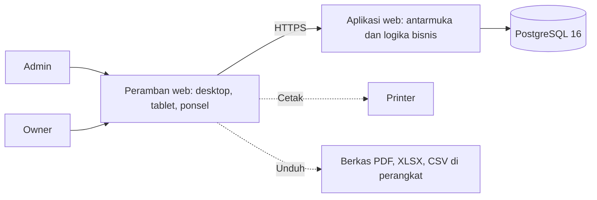
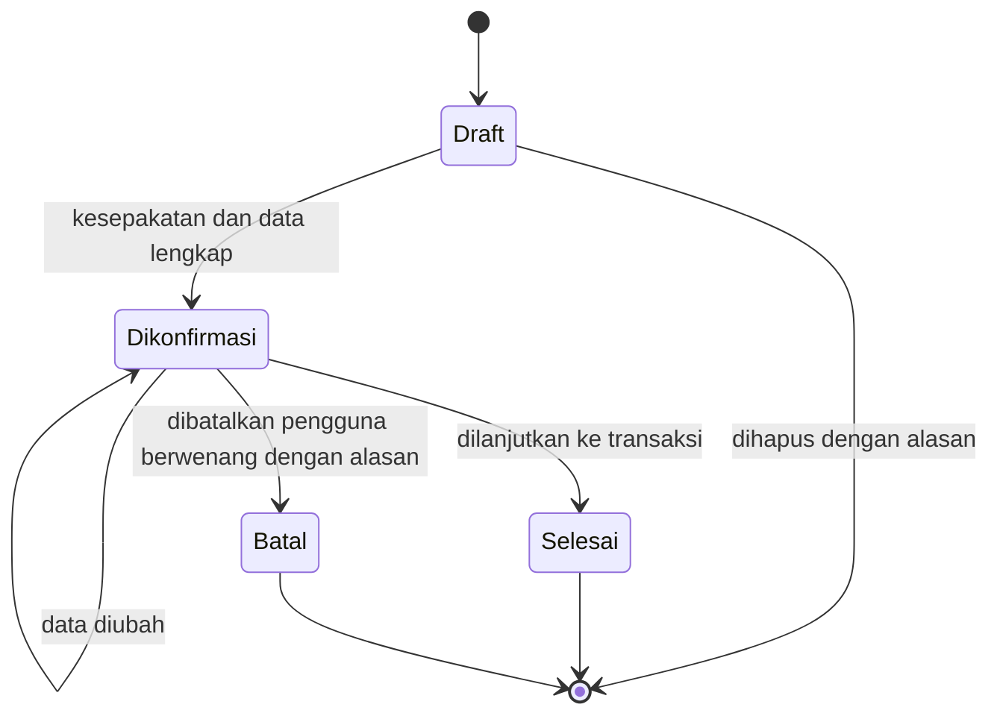
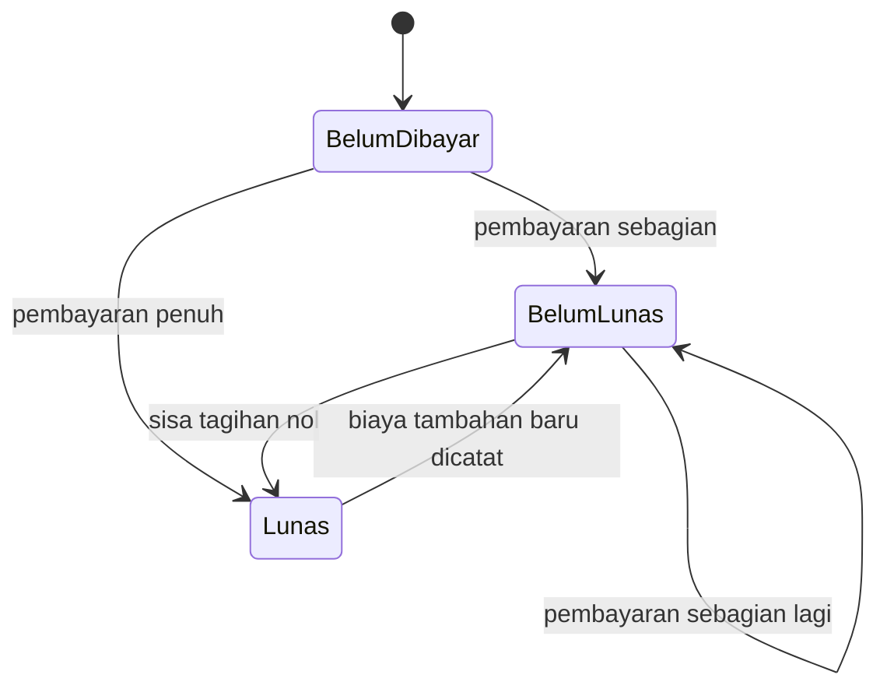
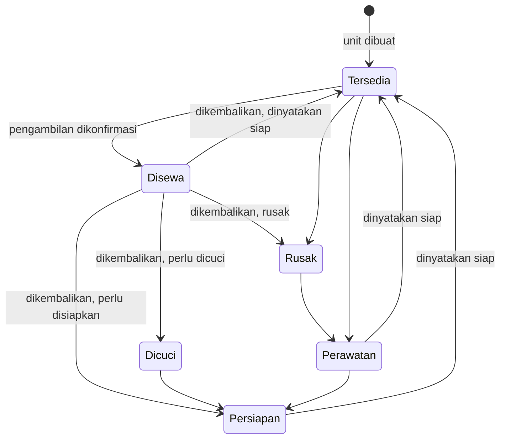

# SOFTWARE REQUIREMENTS SPECIFICATION (SRS)
## Sistem Informasi Penyewaan Perlengkapan Kemah Berbasis Web
### 19 Summit Adventure

| Atribut | Keterangan |
|---|---|
| Nama dokumen | Software Requirements Specification (SRS) |
| Produk | Sistem Informasi Penyewaan Perlengkapan Kemah Berbasis Web |
| Nama usaha | 19 Summit Adventure |
| Versi | 1.0 |
| Tanggal | 23 November 2026 |
| Acuan utama | `PRD.md` |
| Dokumen terkait | `KEBUTUHAN-FUNGSIONAL.md`, `KEBUTUHAN-NON-FUNGSIONAL.md`, `DATABASE-DESIGN.md`, `schema.sql`, `ACTIVITY-DIAGRAM.md` |

---

# 1. Pendahuluan

## 1.1 Tujuan
Dokumen ini menjelaskan spesifikasi kebutuhan perangkat lunak Sistem Informasi Penyewaan Perlengkapan Kemah Berbasis Web secara terstruktur. SRS menjadi acuan bagi perancang, pengembang, dan penguji dalam membangun serta memverifikasi sistem, dan bagi pemilik usaha dalam memastikan sistem sesuai kebutuhan operasional.

## 1.2 Ruang Lingkup
Sistem adalah aplikasi web internal untuk mengelola operasional penyewaan dan penjualan perlengkapan kemah di 19 Summit Adventure, yang mencakup:

- autentikasi, pengguna, dan hak akses;
- dashboard;
- data barang, variasi, unit, kategori, dan paket penyewaan;
- stok dan ketersediaan;
- booking;
- transaksi penyewaan dan penjualan, termasuk cetak bukti/struk;
- pembayaran (DP, pelunasan, biaya tambahan);
- pengembalian barang;
- monitoring transaksi;
- data pelanggan;
- pengeluaran dan kategori pengeluaran;
- laporan (keuangan, penyewaan, penjualan, stok, pelanggan) dengan periode harian dan bulanan, cetak, dan unduh;
- riwayat aktivitas;
- profil akun.

**Di luar ruang lingkup:** pemesanan mandiri oleh pelanggan, payment gateway (sistem hanya mencatat uang yang benar-benar diterima), akun untuk staf persiapan dan pencucian, serta menggantikan proses fisik seperti pencucian dan pemeriksaan barang.

## 1.3 Definisi, Akronim, dan Singkatan

| Istilah | Arti |
|---|---|
| Admin | Pengguna operasional yang mencatat booking, transaksi, pembayaran, pengembalian, stok, dan pengeluaran |
| Owner | Pemilik usaha; memantau usaha, mengakses laporan, dan mengelola pengguna dan hak akses |
| Barang Sewa | Barang yang disewakan; dikelola per unit fisik dengan kode unik |
| Barang Jual | Barang yang dijual; stok dikelola per kuantitas |
| Variasi | Kombinasi spesifikasi sebuah barang (merek, ukuran, kapasitas, jenis, spesifikasi lain) dengan harga sendiri |
| Unit | Satu barang fisik Barang Sewa, memiliki kode unik (misalnya TND001) |
| Paket Penyewaan | Kumpulan beberapa Barang Sewa beserta jumlahnya yang disewa dengan satu harga |
| DP | Uang muka booking, 25% dari total sewa |
| H-n | n hari sebelum tanggal pengambilan |
| Kondisi unit | Kondisi fisik: Tersedia, Disewa, Dicuci, Persiapan, Rusak, Perawatan |
| Alokasi | Status pemesanan unit: Belum Dialokasikan atau Dibooking |
| Struk | Bukti transaksi yang dapat dicetak atau diunduh sebagai PDF |
| DP hangus | DP yang diterima dan tidak dikembalikan akibat booking dibatalkan |
| RBAC | Role-Based Access Control |

## 1.4 Referensi
1. `PRD.md` – Product Requirements Document.
2. `KEBUTUHAN-FUNGSIONAL.md` – kebutuhan fungsional rinci (bagian A sampai O).
3. `KEBUTUHAN-NON-FUNGSIONAL.md` – persyaratan keamanan, kinerja, kemudahan penggunaan, responsivitas, dan keandalan.
4. `DATABASE-DESIGN.md` dan `schema.sql` – rancangan basis data PostgreSQL 16.
5. `ACTIVITY-DIAGRAM.md` – alur aktivitas proses bisnis.
6. Rancangan antarmuka (desain desktop, tablet, dan mobile) sebagai acuan tampilan.

## 1.5 Sistematika Dokumen
Bab 2 memberi gambaran umum produk. Bab 3 menjelaskan antarmuka eksternal. Bab 4 memuat aktor dan use case. Bab 5 memuat kebutuhan fungsional per modul. Bab 6 memuat model data dan status. Bab 7 memuat kebutuhan non-fungsional. Bab 8 memuat aturan bisnis. Bab 9 memuat matriks keterlacakan.

---

# 2. Deskripsi Umum

## 2.1 Perspektif Produk
Sistem berdiri sendiri sebagai aplikasi web yang mengganti pencatatan manual (WhatsApp, nota, buku besar, kertas, spreadsheet). Arsitektur logisnya:

Pelanggan tidak berinteraksi langsung dengan sistem. Pemesanan tetap melalui WhatsApp atau datang ke toko.

## 2.2 Fungsi Produk (Ringkasan)

| Modul | Ringkasan fungsi |
|---|---|
| Autentikasi dan pengguna | Login, logout, RBAC, hak akses khusus, profil akun |
| Dashboard | Ringkasan operasional (Admin) dan ringkasan usaha (Owner) |
| Data barang | Barang, kategori, variasi dan spesifikasi, unit, foto, paket |
| Stok dan ketersediaan | Ringkasan per variasi, Detail Unit, kondisi unit, cek ketersediaan |
| Booking | Catat, ubah, konfirmasi, batal, lanjutkan ke transaksi |
| Transaksi penyewaan | Dari booking atau langsung, unit, jaminan, pengambilan, pelunasan, struk |
| Transaksi penjualan | Keranjang, stok, pembayaran, struk |
| Pembayaran | DP, pelunasan, biaya tambahan, metode tunai, QRIS, transfer |
| Pengembalian | Bertahap, pemeriksaan, biaya tambahan, kondisi unit, jaminan |
| Monitoring | Pemantauan penyewaan dan transaksi |
| Pelanggan | Data dan riwayat pelanggan |
| Pengeluaran | Pencatatan dan kategori pengeluaran |
| Laporan | Lima laporan, periode, cetak, unduh |
| Riwayat aktivitas | Audit aktivitas pengguna |

## 2.3 Karakteristik Pengguna

| Pengguna | Tanggung jawab | Hak akses ringkas |
|---|---|---|
| Admin | Operasional harian | Booking, transaksi, pembayaran, pengembalian, data barang dan paket, stok, pelanggan, pengeluaran dan kategorinya, riwayat aktivitas, profil. Tanpa Laporan dan Kelola Pengguna kecuali diberi hak akses khusus |
| Owner | Pemantauan dan pengelolaan | Dashboard Owner, monitoring booking dan transaksi (tanpa mengubah data operasional), data barang, paket, stok, pelanggan, pengeluaran dan kategorinya, laporan, riwayat aktivitas, kelola pengguna dan hak akses, profil |
| Pegawai dengan hak akses khusus | Misalnya melihat laporan keuangan | Hanya izin yang diberikan Owner |

Pengguna diasumsikan mampu mengoperasikan peramban web. Staf persiapan dan pencucian tidak memiliki akun; perubahan kondisi barang dikoordinasikan kepada Admin.

## 2.4 Batasan
1. Sistem digunakan internal oleh Admin dan Owner.
2. Sistem bukan payment gateway; pembayaran yang dicatat harus sesuai uang yang benar-benar diterima.
3. Basis data memakai PostgreSQL 16.
4. Akses melalui peramban modern dengan koneksi internet.
5. Cetak bergantung pada printer dan pengaturan peramban di perangkat pengguna.
6. Kondisi barang diperbarui pengguna berdasarkan kondisi aktual di toko.
7. Kualitas laporan bergantung pada kelengkapan dan ketepatan data masukan.

## 2.5 Asumsi dan Ketergantungan
1. Toko memiliki koneksi internet yang cukup stabil pada jam operasional (08.00–21.00 WIB).
2. Setiap Admin dan Owner memiliki akun pribadi.
3. Zona waktu yang digunakan adalah WIB.
4. Mata uang Rupiah, tanpa pecahan.
5. Daftar pengguna tersedia pada konfigurasi awal; akun Owner pertama dibuat oleh pengembang.

---

# 3. Kebutuhan Antarmuka Eksternal

## 3.1 Antarmuka Pengguna
| ID | Kebutuhan |
|---|---|
| UI-01 | Antarmuka berbahasa Indonesia dan responsif pada tiga kelas layar: desktop, tablet, dan ponsel. |
| UI-02 | Navigasi mengikuti peran: menu Admin dan menu Owner (lihat PRD bab 7). |
| UI-03 | Formulir pengisian dalam bentuk popup (kategori, hak akses, pembayaran, biaya, cetak, unduh) tampil di tengah layar di atas halaman induk, dengan latar yang diredupkan. |
| UI-04 | Setiap formulir menampilkan pesan validasi yang jelas pada isian yang salah. |
| UI-05 | Aksi penghapusan ditampilkan sesuai aturan modul masing-masing (alasan wajib pada data penting; pembatalan sesaat untuk kategori pengeluaran). |
| UI-06 | Status ditampilkan dengan label teks (bukan warna saja): Belum Dibayar, Belum Lunas, Lunas; Draft, Dikonfirmasi, Selesai; kondisi unit. |
| UI-07 | Halaman daftar menyediakan pencarian, penyaringan, dan penomoran halaman. |

## 3.2 Antarmuka Perangkat Keras
| ID | Kebutuhan |
|---|---|
| HW-01 | Perangkat pengguna: komputer, tablet, atau ponsel dengan peramban modern. |
| HW-02 | Pencetakan melalui printer yang terhubung ke perangkat pengguna, mendukung kertas A4, Letter, dan struk termal 58 mm atau 80 mm. |

## 3.3 Antarmuka Perangkat Lunak
| ID | Kebutuhan |
|---|---|
| SW-01 | Basis data PostgreSQL 16 dengan ekstensi `btree_gist` dan `citext`. |
| SW-02 | Format berkas keluaran: PDF (struk dan laporan), XLSX dan CSV (laporan). |
| SW-03 | Penyimpanan berkas foto produk pada penyimpanan berkas aplikasi atau layanan penyimpanan objek; basis data hanya menyimpan alamatnya. |

## 3.4 Antarmuka Komunikasi
| ID | Kebutuhan |
|---|---|
| CM-01 | Seluruh komunikasi klien dan server menggunakan HTTPS. |
| CM-02 | Sistem tidak berkomunikasi dengan layanan pembayaran eksternal. |

---

# 4. Aktor dan Use Case

## 4.1 Aktor
| Aktor | Keterangan |
|---|---|
| Admin | Pengguna operasional |
| Owner | Pemilik usaha, mewarisi kemampuan Admin pada Pengeluaran dan Paket Penyewaan |
| Pelanggan | Aktor di luar sistem; datanya dicatat oleh Admin |

## 4.2 Daftar Use Case

| ID | Use case | Aktor |
|---|---|---|
| UC-01 | Login dan logout | Admin, Owner |
| UC-02 | Mengelola profil dan password | Admin, Owner |
| UC-03 | Mengelola pengguna dan hak akses | Owner |
| UC-04 | Mengelola kategori, barang, variasi, dan unit | Admin |
| UC-05 | Mengelola Paket Penyewaan | Admin, Owner |
| UC-06 | Memeriksa ketersediaan | Admin |
| UC-07 | Mencatat dan mengelola booking | Admin |
| UC-08 | Membuat transaksi penyewaan (dari booking atau langsung) | Admin |
| UC-09 | Mencatat pembayaran dan pelunasan | Admin |
| UC-10 | Mencetak bukti/struk | Admin |
| UC-11 | Mencatat pengembalian barang | Admin |
| UC-12 | Mengelola kondisi unit | Admin |
| UC-13 | Membuat transaksi penjualan | Admin |
| UC-14 | Mengelola data pelanggan | Admin |
| UC-15 | Mencatat pengeluaran | Admin, Owner |
| UC-16 | Mengelola kategori pengeluaran | Admin, Owner |
| UC-17 | Memantau booking dan transaksi | Owner |
| UC-18 | Melihat laporan | Owner, pegawai berhak akses |
| UC-19 | Mencetak dan mengunduh laporan | Owner, pegawai berhak akses |
| UC-20 | Melihat riwayat aktivitas | Admin, Owner |
| UC-21 | Melihat dashboard | Admin, Owner |

## 4.3 Spesifikasi Use Case Utama

### UC-07 Mencatat Booking
| Item | Isi |
|---|---|
| Aktor | Admin |
| Prakondisi | Admin sudah login; pelanggan menyampaikan kebutuhan lewat WhatsApp atau langsung |
| Alur utama | 1) Admin memeriksa ketersediaan (UC-06). 2) Admin membuka Booking Baru. 3) Admin memilih atau menambah pelanggan. 4) Admin memilih barang pada tab Barang Satuan atau tab Paket (keranjang dipakai bersama). 5) Admin mengisi jumlah, tanggal dan waktu sewa, serta tanggal pengambilan. 6) Sistem menghitung total sewa. 7) Sistem menentukan DP: 25% jika H-2 atau lebih, tanpa DP jika H-1. 8) Admin mencatat penerimaan DP (nominal, tanggal, metode). 9) Sistem membuat kode booking, berstatus Dikonfirmasi, dan mengalokasikan stok. |
| Alur alternatif | A1: barang tidak tersedia, sistem menampilkan peringatan. A2: DP belum diterima, booking disimpan sebagai Draft. A3: Draft dihapus dengan konfirmasi dan alasan, tercatat di Riwayat Aktivitas. A4: booking Dikonfirmasi diubah, riwayat perubahan disimpan. A5: booking dibatalkan oleh pengguna berwenang dengan alasan; DP yang sudah diterima dicatat hangus dan alokasi dilepas. |
| Pascakondisi | Booking tersimpan dan memengaruhi perhitungan ketersediaan pada periodenya |

### UC-08 Membuat Transaksi Penyewaan
| Item | Isi |
|---|---|
| Aktor | Admin |
| Prakondisi | Booking berstatus Dikonfirmasi, atau pelanggan datang langsung |
| Alur utama | 1) Dari booking: Admin memilih Lanjutkan ke Transaksi, data pelanggan, barang, dan periode terisi otomatis dan DP ikut diperhitungkan. Langsung: Admin memilih pelanggan dan barang (satuan atau paket) dan mengisi periode. 2) Sistem memeriksa ketersediaan. 3) Sistem menghitung total. 4) Admin memilih unit fisik untuk barang yang dikelola per unit. 5) Admin mencatat jenis jaminan (KTP, SIM, atau lainnya). 6) Admin mencatat pembayaran. 7) Admin mengonfirmasi pengambilan; sistem mencatat waktu pengambilan dan mengubah unit menjadi Disewa. 8) Sistem menampilkan halaman Transaksi Berhasil. |
| Alur alternatif | A1: stok tidak cukup, Admin mengubah jumlah atau periode. A2: sisa tagihan belum dibayar, status Belum Lunas dan pelunasan dicatat kemudian (UC-09). |
| Pascakondisi | Transaksi tersimpan dengan kode transaksi; booking asal berstatus Selesai |

### UC-09 Mencatat Pembayaran dan Pelunasan
| Item | Isi |
|---|---|
| Aktor | Admin |
| Prakondisi | Transaksi penyewaan berstatus Belum Dibayar atau Belum Lunas |
| Alur utama | 1) Admin membuka detail transaksi dan memilih Catat pembayaran. 2) Admin mengisi nominal, metode (tunai, QRIS, transfer), dan tanggal. 3) Sistem memvalidasi nominal (lebih dari nol dan tidak melebihi sisa tagihan). 4) Sistem menyimpan pembayaran dan menghitung ulang sisa tagihan. 5) Jika sisa nol, status menjadi Lunas dan sistem menampilkan halaman Pelunasan Berhasil. |
| Alur alternatif | A1: nominal tidak valid, sistem menampilkan pesan. A2: sisa masih ada, status tetap Belum Lunas. |
| Pascakondisi | Riwayat pembayaran bertambah, tercatat tanggal, nominal, metode, jenis, dan pengguna |

### UC-10 Mencetak Bukti/Struk
| Item | Isi |
|---|---|
| Aktor | Admin |
| Prakondisi | Detail transaksi atau halaman transaksi berhasil terbuka |
| Alur utama | 1) Admin memilih Cetak Bukti/Struk. 2) Popup tampil di tengah layar. 3) Admin memilih ukuran kertas (58 mm, 80 mm, A4), informasi (nama kasir, rincian pembayaran, syarat dan ketentuan), dan jumlah salinan. 4) Sistem menampilkan pratinjau. 5) Admin memilih Cetak atau Unduh PDF. |
| Catatan | Struk transaksi yang belum lunas menampilkan status Belum Lunas dan sisa tagihan |

### UC-11 Mencatat Pengembalian
| Item | Isi |
|---|---|
| Aktor | Admin |
| Prakondisi | Transaksi penyewaan sudah diambil |
| Alur utama | 1) Admin mencari transaksi. 2) Sistem menampilkan barang yang harus dikembalikan (paket dirinci per barang penyusun). 3) Admin mencatat tanggal, waktu, dan jumlah barang yang dikembalikan. 4) Admin memeriksa kondisi setiap barang dan mencatat yang rusak, hilang, atau tidak lengkap. 5) Sistem menampilkan keterlambatan jika ada. 6) Admin mencatat biaya tambahan (nominal manual dan alasan) dan pembayarannya. 7) Admin menentukan kondisi tiap unit (dicuci, persiapan, rusak, perawatan, atau tersedia setelah dinyatakan siap). 8) Setelah semua barang diperiksa dan kewajiban selesai, Admin mencatat pengembalian jaminan. |
| Alur alternatif | A1: pengembalian bertahap, status Dikembalikan Sebagian sampai seluruh barang kembali |
| Pascakondisi | Status pengembalian dan transaksi diperbarui; riwayat pengembalian tersimpan |

### UC-13 Membuat Transaksi Penjualan
| Item | Isi |
|---|---|
| Aktor | Admin |
| Alur utama | 1) Admin mencari atau memfilter produk Barang Jual. 2) Admin menambah produk ke keranjang dan mengatur jumlah. 3) Sistem memvalidasi stok dan menghitung subtotal dan total. 4) Admin mengisi nominal dan metode pembayaran. 5) Sistem menghitung kembalian, menyimpan transaksi dengan kode otomatis, dan mengurangi stok. 6) Sistem menampilkan halaman Transaksi Berhasil dengan opsi Cetak Bukti/Struk. |
| Alur alternatif | A1: jumlah melebihi stok, transaksi tidak dapat disimpan sampai jumlah disesuaikan |

### UC-18 dan UC-19 Laporan, Cetak, dan Unduh
| Item | Isi |
|---|---|
| Aktor | Owner atau pegawai berhak akses |
| Alur utama | 1) Pengguna memilih laporan. 2) Pengguna memilih jenis periode Harian (pilih tanggal) atau Bulanan (pilih bulan) dan dapat berpindah ke periode sebelumnya atau berikutnya. 3) Sistem menampilkan laporan. 4) Cetak: popup memilih ukuran kertas (A4 atau Letter), orientasi, isi (ringkasan, rincian, kop dan tanda tangan), dan salinan. 5) Unduh: popup memilih format (PDF, Excel, CSV), isi (ringkasan dan rincian atau rincian saja; CSV hanya rincian), dan menampilkan nama berkas otomatis dari jenis laporan dan periode. |
| Alur alternatif | A1: tidak ada isi cetak yang dipilih, sistem meminta minimal satu. A2: pengguna tanpa hak akses ditolak |

---

# 5. Kebutuhan Fungsional

Setiap kebutuhan memuat ID, deskripsi, prioritas (T = Tinggi, S = Sedang, R = Rendah), dan rujukan bagian pada `KEBUTUHAN-FUNGSIONAL.md` (KF). Rincian butir demi butir mengikuti KF.

## 5.1 Autentikasi dan Pengguna (KF bagian A, N, O)
| ID | Kebutuhan | Prior. |
|---|---|---|
| FR-AUT-01 | Sistem menyediakan halaman login dengan username atau email dan password. | T |
| FR-AUT-02 | Sistem menolak login untuk kredensial salah atau akun nonaktif dengan pesan yang tidak membuka detail penyebab. | T |
| FR-AUT-03 | Sistem menyediakan logout yang mengakhiri sesi. | T |
| FR-AUT-04 | Sistem membedakan hak akses Admin dan Owner serta menampilkan menu sesuai peran. | T |
| FR-AUT-05 | Sistem mencegah akses langsung ke halaman atau aksi di luar hak akses, termasuk melalui URL. | T |
| FR-AUT-06 | Akun Owner pertama dibuat oleh pengembang saat konfigurasi awal. | T |
| FR-USR-01 | Owner dapat membuat akun Admin, melihat, mengubah, menonaktifkan, dan mereset password pengguna. | T |
| FR-USR-02 | Owner dapat mencari dan menyaring pengguna berdasarkan nama, peran, dan status. | S |
| FR-USR-03 | Owner dapat memberikan hak akses khusus kepada pengguna tertentu (misalnya laporan keuangan). | S |
| FR-USR-04 | Sistem mencatat perubahan akun dan hak akses beserta pelaku dan waktunya. | T |
| FR-PRF-01 | Pengguna dapat melihat dan mengubah profilnya sendiri. | S |
| FR-PRF-02 | Perubahan password mewajibkan password lama, konfirmasi password baru, dan opsi menampilkan password yang diketik. | T |

## 5.2 Dashboard (KF bagian B)
| ID | Kebutuhan | Prior. |
|---|---|---|
| FR-DSB-01 | Dashboard Admin menampilkan booking yang perlu diproses, jadwal pengambilan dan pengembalian hari ini, keterlambatan, ringkasan kondisi stok, serta transaksi dan pengeluaran terbaru. | T |
| FR-DSB-02 | Dashboard Owner menampilkan pendapatan diterima, pengeluaran, jumlah transaksi sewa dan jual, booking aktif, dan transaksi berjalan. | T |
| FR-DSB-03 | Dashboard Owner menampilkan grafik pendapatan dan pengeluaran per periode, barang paling sering disewa, produk terlaris, pelanggan teratas, dan aktivitas terbaru. | S |

## 5.3 Data Barang (KF bagian C)
| ID | Kebutuhan | Prior. |
|---|---|---|
| FR-BRG-01 | Admin dapat menambah, melihat, mengubah, dan menghapus barang dan kategori barang sesuai hak akses. | T |
| FR-BRG-02 | Satu formulir penambahan barang dengan pilihan jenis Barang Sewa atau Barang Jual; isian menyesuaikan jenis. | T |
| FR-BRG-03 | Barang memiliki nama, kode, kategori, deskripsi, jenis, spesifikasi, dan foto. | T |
| FR-BRG-04 | Pada Barang Sewa, Admin memilih spesifikasi yang dipakai (merek, ukuran, kapasitas, jenis) melalui kotak centang; hanya kolom terpilih yang tampil pada tabel variasi. | T |
| FR-BRG-05 | Admin dapat menambah spesifikasi lain di luar bawaan, maksimal tiga per barang, dengan validasi nama dan dapat menghapusnya. | S |
| FR-BRG-06 | Admin dapat menambah baris variasi; setiap variasi memiliki nilai spesifikasi, harga sewa, dan jumlah unit. Variasi ganda ditolak. | T |
| FR-BRG-07 | Sistem membuat unit fisik untuk setiap variasi Barang Sewa dengan kode unik otomatis dan penomoran yang berlanjut tanpa kode ganda. | T |
| FR-BRG-08 | Barang Jual memiliki harga jual dan stok kuantitas. | T |
| FR-BRG-09 | Admin dapat mengunggah foto produk; foto tampil pada Semua Barang dan Detail Barang. | S |
| FR-BRG-10 | Pencarian dan penyaringan barang berdasarkan nama, kode, kategori, dan jenis. | T |
| FR-BRG-11 | Sistem meminta konfirmasi sebelum penghapusan dan mencegah penghapusan barang yang terkait transaksi atau riwayat penting tanpa mekanisme yang sesuai. | T |
| FR-PKT-01 | Admin dan Owner dapat menambah, melihat, mengubah, dan menonaktifkan Paket Penyewaan. | T |
| FR-PKT-02 | Paket memiliki kode, nama, deskripsi, harga sewa, dan daftar barang penyusun beserta jumlahnya; hanya Barang Sewa yang dapat menjadi penyusun. | T |
| FR-PKT-03 | Daftar paket ditampilkan sebagai kartu pada desktop dan tablet, dengan pencarian berdasarkan kode dan nama. | S |
| FR-PKT-04 | Komposisi dan harga paket yang sudah dipakai pada booking atau transaksi tidak berubah ketika paket diubah. | T |

## 5.4 Stok dan Ketersediaan (KF bagian D)
| ID | Kebutuhan | Prior. |
|---|---|---|
| FR-STK-01 | Sistem menampilkan Ringkasan per Variasi: total, tersedia, disewa, dicuci, persiapan, rusak, dan perawatan. | T |
| FR-STK-02 | Sistem menyediakan Detail Unit per variasi: daftar seluruh unit dengan kode unik dan kondisinya, pencarian dan filter kode serta kondisi, dan navigasi kembali. | T |
| FR-STK-03 | Admin dapat mengubah kondisi setiap unit (Tersedia, Disewa, Dicuci, Persiapan, Rusak, Perawatan); sistem mencatat kondisi lama, baru, waktu, dan pengguna. | T |
| FR-STK-04 | Ringkasan stok selalu mengikuti data kondisi unit individual. | T |
| FR-STK-05 | Sistem membedakan kondisi fisik dengan alokasi (Belum Dialokasikan atau Dibooking). | T |
| FR-STK-06 | Admin dapat menambah stok per variasi; sistem membuat unit baru dan mencatat riwayat. | T |
| FR-STK-07 | Stok Barang Jual dikelola per kuantitas dengan penyesuaian dan riwayatnya. | T |
| FR-STK-08 | Pengecekan ketersediaan berdasarkan tanggal mulai, tanggal selesai, dan variasi atau paket, dengan memperhitungkan booking dikonfirmasi, transaksi aktif, kondisi unit, dan periode. | T |
| FR-STK-09 | Ketersediaan paket dihitung dari barang penyusunnya, memperhitungkan pemakaian variasi yang sama secara satuan maupun dalam paket, dan menampilkan rincian kebutuhan dan ketersediaan tiap penyusun. | T |
| FR-STK-10 | Satu unit tidak boleh dialokasikan pada dua penyewaan dengan periode yang bertumpang tindih. | T |
| FR-STK-11 | Unit yang dikembalikan tidak otomatis Tersedia; berubah setelah diperiksa dan dinyatakan siap. | T |

## 5.5 Booking (KF bagian E)
| ID | Kebutuhan | Prior. |
|---|---|---|
| FR-BKG-01 | Admin dapat mencatat booking dengan data pelanggan, barang, jumlah, periode sewa, tanggal pengambilan, dan harga. | T |
| FR-BKG-02 | Sistem membuat kode booking otomatis (format BK-nnnn). | T |
| FR-BKG-03 | Katalog pada pencatatan booking dipisah menjadi tab Barang Satuan dan Paket dengan keranjang bersama. | S |
| FR-BKG-04 | Sistem menghitung total berdasarkan barang, jumlah, dan durasi, dan untuk paket berdasarkan harga paket, jumlah paket, dan durasi. | T |
| FR-BKG-05 | Booking H-2 atau lebih dikenai DP 25% dari total; booking H-1 menampilkan informasi tanpa DP. | T |
| FR-BKG-06 | Admin dapat mencatat DP: nominal, tanggal, dan metode (tunai, QRIS, transfer). | T |
| FR-BKG-07 | Status booking: Draft, Dikonfirmasi, Selesai (dan Batal). | T |
| FR-BKG-08 | Pencarian booking berdasarkan kode, nama pelanggan, dan nomor telepon; filter status dan tanggal pengambilan. | T |
| FR-BKG-09 | Admin dapat mengubah booking dengan riwayat perubahan tersimpan. | T |
| FR-BKG-10 | Draft dapat dihapus melalui konfirmasi dan alasan; tercatat pada Riwayat Aktivitas. | T |
| FR-BKG-11 | Pembatalan booking hanya oleh pengguna berwenang dengan alasan; DP yang diterima dicatat hangus sebagai penerimaan terkait booking; alokasi stok dilepas; riwayat pembatalan tersimpan. | T |
| FR-BKG-12 | Booking Dikonfirmasi dapat dilanjutkan ke Transaksi Penyewaan tanpa input ulang. | T |
| FR-BKG-13 | Sistem menyimpan snapshot komposisi dan harga paket pada booking. | T |

## 5.6 Transaksi Penyewaan (KF bagian F.1)
| ID | Kebutuhan | Prior. |
|---|---|---|
| FR-TSW-01 | Transaksi dapat berasal dari booking atau dibuat langsung tanpa booking. | T |
| FR-TSW-02 | Pemilihan barang satuan dan paket melalui tab katalog dengan keranjang bersama. | S |
| FR-TSW-03 | Sistem menampilkan ketersediaan menurut periode dan memvalidasi sebelum menyimpan. | T |
| FR-TSW-04 | Admin memilih unit fisik untuk barang yang dikelola per unit; untuk paket, unit penyusun dicatat tersendiri. | T |
| FR-TSW-05 | Sistem membuat kode transaksi otomatis (format TS-nnnn). | T |
| FR-TSW-06 | Sistem mencatat tanggal dan waktu mulai dan selesai, serta jaminan (KTP, SIM, atau lainnya). | T |
| FR-TSW-07 | Status transaksi, status pembayaran, dan status pengambilan ditampilkan terpisah. | T |
| FR-TSW-08 | Pengambilan barang dikonfirmasi Admin; sistem mencatat waktu dan mengubah unit menjadi Disewa. | T |
| FR-TSW-09 | DP dari booking diintegrasikan tanpa dicatat ulang; sisa tagihan = total dikurangi seluruh pembayaran. | T |
| FR-TSW-10 | Detail transaksi menampilkan jaminan, rincian barang, dan riwayat pembayaran. | T |
| FR-TSW-11 | Pencarian dan filter berdasarkan kode, pelanggan, periode, dan status. | T |
| FR-TSW-12 | Riwayat perubahan transaksi disimpan. | T |
| FR-TSW-13 | Halaman transaksi penyewaan langsung yang berhasil menyediakan tombol kembali ke menu Transaksi Penyewaan dan opsi Cetak Bukti/Struk. | S |

## 5.7 Transaksi Penjualan (KF bagian F.2)
| ID | Kebutuhan | Prior. |
|---|---|---|
| FR-TJL-01 | Sistem menampilkan Barang Jual dengan harga dan stok, serta pencarian dan filter nama, kode, dan kategori. | T |
| FR-TJL-02 | Admin dapat menambahkan beberapa jenis barang ke satu keranjang dan mengatur jumlah. | T |
| FR-TJL-03 | Sistem menghitung subtotal, total, dan kembalian. | T |
| FR-TJL-04 | Sistem membuat kode transaksi otomatis (format TJ-nnnn). | T |
| FR-TJL-05 | Sistem memvalidasi stok dan mengurangi stok setelah transaksi tersimpan. | T |
| FR-TJL-06 | Detail Penjualan menampilkan kode, pelanggan, barang, jumlah, harga, total, nominal bayar, kembalian, dan riwayat pembayaran. | T |
| FR-TJL-07 | Pencarian dan filter berdasarkan kode dan periode. | T |
| FR-TJL-08 | Riwayat perubahan transaksi disimpan. | S |

## 5.8 Pembayaran dan Cetak Bukti (KF bagian G dan F)
| ID | Kebutuhan | Prior. |
|---|---|---|
| FR-BYR-01 | Pembayaran dicatat pada detail transaksi; tidak ada menu pembayaran terpisah. | T |
| FR-BYR-02 | Metode: tunai, QRIS, dan transfer; jenis: DP, pelunasan, biaya tambahan, penjualan. | T |
| FR-BYR-03 | Pembayaran dapat dicatat bertahap; sistem menghitung ulang sisa setelah setiap pembayaran. | T |
| FR-BYR-04 | Status pembayaran otomatis: Belum Dibayar, Belum Lunas, Lunas. | T |
| FR-BYR-05 | Setelah pelunasan tercatat, sistem menampilkan halaman Pelunasan Berhasil dengan rincian, riwayat DP dan pelunasan, tombol cetak bukti, lihat detail, dan kembali ke menu Transaksi Penyewaan. | S |
| FR-BYR-06 | Riwayat pembayaran menyimpan tanggal, nominal, metode, jenis, dan pengguna pencatat. | T |
| FR-STR-01 | Cetak Bukti/Struk tersedia pada detail transaksi penyewaan dan penjualan serta halaman transaksi berhasil. | S |
| FR-STR-02 | Popup struk menyediakan ukuran kertas 58 mm, 80 mm, A4; opsi nama kasir, rincian pembayaran, syarat dan ketentuan; jumlah salinan; pratinjau; aksi cetak dan unduh PDF. | S |
| FR-STR-03 | Struk transaksi belum lunas menampilkan status dan sisa tagihan. | S |

## 5.9 Pengembalian (KF bagian H)
| ID | Kebutuhan | Prior. |
|---|---|---|
| FR-KMB-01 | Sistem menampilkan transaksi yang memiliki jadwal pengembalian dan mendukung pencarian kode, pelanggan, dan tanggal. | T |
| FR-KMB-02 | Admin mencatat tanggal dan waktu serta jumlah barang yang dikembalikan; pengembalian dapat bertahap. | T |
| FR-KMB-03 | Admin memeriksa kondisi barang dan mencatat rusak, hilang, atau tidak lengkap. | T |
| FR-KMB-04 | Sistem menampilkan keterlambatan menurut tanggal pengembalian dan jam operasional (lewat pukul 21.00 WIB dianggap terlambat). | T |
| FR-KMB-05 | Admin mencatat biaya tambahan (denda keterlambatan, kerusakan, kehilangan) dengan nominal manual dan alasan wajib; biaya masuk ke tagihan transaksi. | T |
| FR-KMB-06 | Biaya tambahan dapat dibayar dengan tunai, QRIS, atau transfer. | T |
| FR-KMB-07 | Setelah pemeriksaan, kondisi unit ditetapkan: Dicuci, Persiapan, Rusak, Perawatan, atau Tersedia setelah dinyatakan siap. | T |
| FR-KMB-08 | Pengembalian paket dicatat per barang penyusun; penyelesaian memperhitungkan seluruh penyusun. | T |
| FR-KMB-09 | Pengembalian jaminan dicatat setelah seluruh barang diperiksa dan kewajiban pembayaran selesai. | T |
| FR-KMB-10 | Riwayat pengembalian dan biaya tambahan tersimpan pada transaksi. | T |

## 5.10 Monitoring (KF bagian I)
| ID | Kebutuhan | Prior. |
|---|---|---|
| FR-MON-01 | Sistem menampilkan penyewaan berjalan: pelanggan, barang, tanggal pengambilan, dan jadwal pengembalian. | T |
| FR-MON-02 | Status penyewaan: Sedang Disewa, Menunggu Pengembalian, Terlambat, Selesai; status pengembalian: Belum Dikembalikan, Dikembalikan Sebagian, Dikembalikan Seluruhnya. | T |
| FR-MON-03 | Sistem menampilkan lama keterlambatan, status pembayaran, sisa tagihan, dan biaya tambahan. | T |
| FR-MON-04 | Owner memantau transaksi sewa dan jual tanpa mengubah data operasional. | T |
| FR-MON-05 | Pencarian dan filter berdasarkan kode, pelanggan, status, dan periode; riwayat penyewaan selesai tersedia. | S |

## 5.11 Data Pelanggan (KF bagian J)
| ID | Kebutuhan | Prior. |
|---|---|---|
| FR-PLG-01 | Data pelanggan tersimpan otomatis saat dicatat pada booking atau transaksi dan dapat dipakai ulang. | T |
| FR-PLG-02 | Kode pelanggan otomatis (PL-nnnn); nama dan nomor telepon wajib, alamat dan lainnya opsional. | T |
| FR-PLG-03 | Sistem mencegah pelanggan ganda (nomor telepon unik). | T |
| FR-PLG-04 | Pencarian berdasarkan kode, nama, dan telepon. | T |
| FR-PLG-05 | Detail pelanggan menampilkan jumlah transaksi (satu rangkaian booking yang dilanjutkan dihitung satu transaksi sewa) dan riwayat booking, penyewaan, dan penjualan. | T |

## 5.12 Pengeluaran (KF bagian K)
| ID | Kebutuhan | Prior. |
|---|---|---|
| FR-PGL-01 | Admin dan Owner mencatat pengeluaran: keterangan, kategori, tanggal, nominal, metode, dan status sudah atau belum dibayar. | T |
| FR-PGL-02 | Admin dan Owner dapat menambah, melihat, dan mengubah pengeluaran; perubahan tercatat dalam riwayat. | T |
| FR-PGL-03 | Pencarian dan filter berdasarkan kategori dan periode; total dan rincian per kategori ditampilkan. | T |
| FR-PGL-04 | Admin dan Owner dapat mengelola kategori melalui Kelola Kategori: tambah, ubah nama, aktifkan atau nonaktifkan, dan hapus. Nama kosong atau ganda ditolak. | T |
| FR-PGL-05 | Penghapusan kategori dapat dibatalkan (undo) sesaat setelah dihapus. | S |
| FR-PGL-06 | Hanya kategori aktif yang dapat dipilih pada pencatatan pengeluaran. | T |

## 5.13 Laporan (KF bagian L)
| ID | Kebutuhan | Prior. |
|---|---|---|
| FR-LAP-01 | Menu Laporan hanya dapat diakses Owner dan pengguna dengan hak akses khusus. | T |
| FR-LAP-02 | Sistem menyediakan Laporan Keuangan, Penyewaan, Penjualan, Stok, dan Pelanggan. | T |
| FR-LAP-03 | Setiap laporan menyediakan filter periode Harian (pilih tanggal) dan Bulanan (pilih bulan), dengan navigasi periode sebelumnya atau berikutnya; periode tidak melebihi hari atau bulan berjalan. | T |
| FR-LAP-04 | Laporan Keuangan menampilkan pembayaran diterima, pengeluaran, selisih, belum diterima, rincian pendapatan penyewaan dan penjualan, penerimaan tambahan (denda, kerusakan, kehilangan, DP hangus) terpisah dari pendapatan sewa, dan pengeluaran per kategori; tagihan dibedakan dari uang yang benar-benar diterima. | T |
| FR-LAP-05 | Laporan Penyewaan menampilkan jumlah transaksi, pendapatan, barang tersewa, frekuensi per barang, paket yang disewa dan pendapatannya, status pembayaran, dan keterlambatan. | T |
| FR-LAP-06 | Laporan Penjualan menampilkan pendapatan, jumlah transaksi, produk terjual beserta nilai, pengurutan, dan riwayat per pelanggan. | T |
| FR-LAP-07 | Laporan Stok menampilkan stok per kondisi, per kategori dan jenis, alokasi booking, barang belum dikembalikan, pergerakan stok, dan perubahan kondisi. | T |
| FR-LAP-08 | Laporan Pelanggan menampilkan transaksi sewa dan jual terpisah, total nilai, pengurutan, dan pelanggan paling sering bertransaksi, dengan Detail. | T |
| FR-LAP-09 | Laporan Keuangan menyediakan halaman Detail Laporan berisi rincian transaksi pembentuk angka. | S |
| FR-LAP-10 | Fitur Cetak menghasilkan keluaran kertas melalui popup pengaturan: ukuran kertas (A4, Letter), orientasi (potret, lanskap), isi (ringkasan, rincian tabel, kop dan tanda tangan; minimal satu), jumlah salinan, dan pratinjau. | T |
| FR-LAP-11 | Fitur Unduh menyimpan berkas melalui popup pengaturan: format PDF, Excel, atau CSV; isi (ringkasan dan rincian, atau rincian saja; CSV hanya rincian); nama berkas otomatis dari jenis laporan dan periode. | T |

## 5.14 Riwayat Aktivitas (KF bagian M)
| ID | Kebutuhan | Prior. |
|---|---|---|
| FR-RWY-01 | Sistem mencatat login, logout, tambah, ubah, hapus, pembatalan, dan perubahan status penting (booking, penyewaan, pengembalian, kondisi barang). | T |
| FR-RWY-02 | Setiap catatan menyimpan jenis aktivitas, pengguna, waktu, data terkait, dan data sebelum dan sesudah perubahan. | T |
| FR-RWY-03 | Penghapusan data tertentu mewajibkan alasan yang tersimpan. | T |
| FR-RWY-04 | Pencarian dan filter berdasarkan pengguna, jenis aktivitas, dan periode; tersedia detail aktivitas. | T |
| FR-RWY-05 | Riwayat tidak dapat diubah atau dihapus oleh pengguna dan tetap ada meski data operasional dihapus dari tampilan. | T |
| FR-RWY-06 | Admin dan Owner dapat mengakses riwayat sesuai hak aksesnya. | T |

---

# 6. Model Data dan Status

## 6.1 Entitas Utama
Rancangan lengkap ada di `DATABASE-DESIGN.md` dan `schema.sql`. Entitas utamanya:

| Kelompok | Entitas |
|---|---|
| Akses dan audit | pengguna, izin, pengguna_izin, riwayat_aktivitas |
| Pelanggan | pelanggan |
| Barang dan stok | kategori_barang, barang, barang_spesifikasi, variasi_barang, unit_barang, riwayat_kondisi_unit, riwayat_stok |
| Paket | paket, paket_isi |
| Booking | booking, booking_item |
| Penyewaan | transaksi_sewa, transaksi_sewa_item, transaksi_sewa_unit |
| Pengembalian | pengembalian, pengembalian_detail, biaya_tambahan |
| Penjualan | transaksi_jual, transaksi_jual_item |
| Pembayaran | pembayaran |
| Pengeluaran | kategori_pengeluaran, pengeluaran |
| Sistem | pengaturan |

## 6.2 Status Booking

## 6.3 Status Pembayaran Transaksi

## 6.4 Kondisi Unit Barang Sewa

Admin dapat mengubah kondisi unit secara manual sesuai hasil pemeriksaan; perubahan selalu dicatat.

## 6.5 Format Kode Otomatis
| Objek | Format | Contoh |
|---|---|---|
| Booking | BK-nnnn | BK-0239 |
| Transaksi penyewaan | TS-nnnn | TS-0412 |
| Transaksi penjualan | TJ-nnnn | TJ-0127 |
| Pelanggan | PL-nnnn | PL-0001 |
| Paket | PK-nnn | PK-001 |
| Unit barang | awalan variasi + urutan 3 digit | TND001 |

---

# 7. Kebutuhan Non-Fungsional

Nilai target di bawah ini adalah usulan awal yang perlu disahkan pemilik usaha. Rincian lengkap berada pada `KEBUTUHAN-NON-FUNGSIONAL.md`.

## 7.1 Keamanan
| ID | Kebutuhan |
|---|---|
| NFR-SEC-01 | Password disimpan sebagai hash dengan algoritme yang kuat (misalnya Argon2 atau bcrypt) dan tidak pernah dalam bentuk asli. |
| NFR-SEC-02 | Seluruh lalu lintas memakai HTTPS. |
| NFR-SEC-03 | Hak akses diperiksa di sisi server pada setiap permintaan, bukan hanya dengan menyembunyikan menu. |
| NFR-SEC-04 | Sesi berakhir setelah tidak aktif selama periode tertentu (usulan 30 menit) dan dibatalkan saat logout. |
| NFR-SEC-05 | Sistem melindungi dari serangan umum: injeksi SQL (kueri berparameter), XSS, dan CSRF. |
| NFR-SEC-06 | Percobaan login gagal berulang dibatasi. |
| NFR-SEC-07 | Riwayat aktivitas dilindungi dari perubahan dan penghapusan (terjamin hingga tingkat basis data). |
| NFR-SEC-08 | Akun yang dinonaktifkan tidak dapat masuk. |

## 7.2 Kinerja
| ID | Kebutuhan |
|---|---|
| NFR-PRF-01 | Halaman utama dan daftar termuat dalam 3 detik pada koneksi normal untuk data hingga puluhan ribu baris. |
| NFR-PRF-02 | Pencarian dan pengecekan ketersediaan menampilkan hasil dalam 2 detik. |
| NFR-PRF-03 | Laporan bulanan tampil dalam 5 detik. |
| NFR-PRF-04 | Sistem melayani minimal 10 pengguna bersamaan tanpa penurunan berarti. |
| NFR-PRF-05 | Daftar besar memakai penomoran halaman. |

## 7.3 Kemudahan Penggunaan
| ID | Kebutuhan |
|---|---|
| NFR-USA-01 | Antarmuka berbahasa Indonesia dengan istilah yang konsisten dengan operasional toko. |
| NFR-USA-02 | Alur utama (booking, transaksi, pembayaran, pengembalian) dapat diselesaikan Admin tanpa pelatihan panjang. |
| NFR-USA-03 | Pesan kesalahan menjelaskan penyebab dan cara memperbaikinya. |
| NFR-USA-04 | Tindakan penting memerlukan konfirmasi; tindakan yang mudah dibatalkan menyediakan pembatalan (undo). |
| NFR-USA-05 | Status ditampilkan dengan teks dan bukan hanya warna. |

## 7.4 Responsivitas dan Kompatibilitas
| ID | Kebutuhan |
|---|---|
| NFR-RSP-01 | Seluruh halaman dapat dipakai pada desktop, tablet, dan ponsel. |
| NFR-RSP-02 | Kompatibel dengan versi terbaru peramban utama (Chrome, Edge, Firefox, Safari). |
| NFR-RSP-03 | Popup tidak terpotong pada layar kecil dan dapat digulir. |

## 7.5 Keandalan dan Integritas Data
| ID | Kebutuhan |
|---|---|
| NFR-REL-01 | Operasi yang mengubah beberapa data (pembayaran, stok, kondisi unit, riwayat) dijalankan dalam satu transaksi basis data. |
| NFR-REL-02 | Basis data mencegah alokasi ganda unit pada periode bertumpang tindih. |
| NFR-REL-03 | Pencadangan basis data otomatis minimal harian dan dapat dipulihkan (usulan retensi 30 hari). |
| NFR-REL-04 | Ketersediaan sistem pada jam operasional 08.00–21.00 WIB (target 99%). |
| NFR-REL-05 | Nilai uang disimpan dalam Rupiah utuh tanpa pembulatan floating point. |

## 7.6 Pemeliharaan
| ID | Kebutuhan |
|---|---|
| NFR-MNT-01 | Skema basis data dikelola melalui migrasi berversi. |
| NFR-MNT-02 | Parameter bisnis (persentase DP, batas hari DP, jam operasional) disimpan pada tabel pengaturan. |
| NFR-MNT-03 | Dokumentasi PRD, SRS, desain basis data, dan diagram aktivitas dijaga konsisten. |

---

# 8. Aturan Bisnis

| ID | Aturan | Sumber |
|---|---|---|
| BR-01 | Booking H-2 atau lebih awal wajib DP 25% dari total sewa. | PRD 6.1 |
| BR-02 | Booking H-1 tidak diwajibkan DP. | PRD 6.2 |
| BR-03 | Pelunasan pada umumnya dilakukan ketika pelanggan mengambil barang; sistem tetap mencatat pelunasan susulan pada transaksi yang berstatus Belum Lunas. | PRD 6.3 |
| BR-04 | Booking tidak dapat dibatalkan secara bebas; jika dibatalkan oleh pengguna berwenang, DP yang dibayar hangus dan dicatat sebagai penerimaan terkait booking. | PRD 6.4 |
| BR-05 | Pembayaran yang dicatat sesuai uang yang benar-benar diterima. | PRD 6.5 |
| BR-06 | Metode pembayaran: tunai, QRIS, transfer. | PRD 6.6 |
| BR-07 | Transaksi penyewaan berasal dari booking atau penyewaan langsung. | PRD 6.7 |
| BR-08 | Penyewaan dapat berupa barang satuan maupun paket. | PRD 6.8 |
| BR-09 | Booking dikonfirmasi dan sewa aktif diperhitungkan dalam ketersediaan menurut periodenya. | PRD 6.9 |
| BR-10 | Unit berkondisi Dicuci, Persiapan, Rusak, atau Perawatan tidak dianggap siap disewakan. | PRD 6.10 |
| BR-11 | Unit yang dikembalikan tidak otomatis Tersedia sebelum kondisinya diperbarui. | PRD 6.11 |
| BR-12 | Pembayaran, pengembalian, dan perubahan data terhubung dengan transaksinya. | PRD 6.12 |
| BR-13 | Hak akses Admin dan Owner dibedakan sesuai tanggung jawab. | PRD 6.13 |
| BR-14 | DP pada booking diperhitungkan pada transaksi penyewaan tanpa dicatat ulang. | PRD 6.14 |
| BR-15 | Penerimaan tambahan (denda, kerusakan, kehilangan, DP hangus) dilaporkan terpisah dari pendapatan penyewaan. | PRD 6.15, 6.16 |
| BR-16 | Biaya tambahan diinput manual dengan alasan wajib. | PRD 6.16 |
| BR-17 | Jam operasional 08.00–21.00 WIB; pengembalian setelah 21.00 atau lewat tanggal kembali dianggap terlambat. | PRD 6.17 |
| BR-18 | Satu unit tidak boleh dialokasikan pada dua penyewaan yang periodenya bertumpang tindih. | PRD 6.18 |
| BR-19 | Komposisi dan harga paket pada booking dan transaksi dipertahankan. | PRD 6.19 |
| BR-20 | Penjualan tidak boleh melebihi stok. | PRD 6.20 |
| BR-21 | Jenis Barang Jual tidak dapat menjadi penyusun Paket Penyewaan. | KF C.23 |
| BR-22 | Satu pelanggan dengan nomor telepon yang sama tidak dicatat dua kali. | KF J.9 |

---

# 9. Matriks Keterlacakan

| Fitur PRD (bab 4.1) | Kebutuhan SRS | Use case | Tabel utama |
|---|---|---|---|
| A. Autentikasi dan pengguna | FR-AUT, FR-USR, FR-PRF | UC-01, 02, 03 | pengguna, izin, pengguna_izin |
| B. Dashboard | FR-DSB | UC-21 | (query) |
| C. Data barang | FR-BRG, FR-PKT | UC-04, 05 | barang, variasi_barang, unit_barang, paket, paket_isi |
| D. Booking | FR-BKG | UC-07 | booking, booking_item, pembayaran |
| E. Transaksi penyewaan | FR-TSW, FR-STR | UC-08, 10 | transaksi_sewa, transaksi_sewa_item, transaksi_sewa_unit |
| F. Transaksi penjualan | FR-TJL, FR-STR | UC-13, 10 | transaksi_jual, transaksi_jual_item |
| G. Pembayaran | FR-BYR | UC-09 | pembayaran |
| H. Pengembalian | FR-KMB | UC-11 | pengembalian, pengembalian_detail, biaya_tambahan |
| I. Stok dan ketersediaan | FR-STK, FR-MON | UC-06, 12, 17 | unit_barang, riwayat_kondisi_unit, riwayat_stok |
| J. Data pelanggan | FR-PLG | UC-14 | pelanggan |
| K. Pengeluaran | FR-PGL | UC-15, 16 | pengeluaran, kategori_pengeluaran |
| L. Laporan | FR-LAP | UC-18, 19 | view v_penerimaan, v_stok_variasi, v_monitoring_sewa |
| M. Riwayat aktivitas | FR-RWY | UC-20 | riwayat_aktivitas |

---

# 10. Lampiran

## 10.1 Ringkasan Hak Akses Menu

| Menu | Admin | Owner |
|---|---|---|
| Dashboard | Ya (Dashboard Admin) | Ya (Dashboard Owner) |
| Booking | Kelola | Pantau (Monitoring Booking) |
| Transaksi Penyewaan dan Penjualan | Kelola | Pantau (Monitoring Transaksi) |
| Data Barang (Semua Barang, Kategori) | Kelola | Lihat |
| Paket Penyewaan | Kelola | Kelola |
| Stok dan Ketersediaan | Kelola | Pantau |
| Data Pelanggan | Kelola | Lihat |
| Pengembalian | Kelola | Tidak ada |
| Pengeluaran dan Kelola Kategori | Kelola | Kelola |
| Laporan | Hanya dengan hak akses khusus | Ya |
| Riwayat Aktivitas | Ya | Ya |
| Kelola Pengguna dan Hak Akses | Tidak | Ya |
| Profil Akun | Ya | Ya |

## 10.2 Pertanyaan Terbuka
1. Penyelarasan aturan BR-03 (pelunasan saat pengambilan) dengan perilaku sistem yang memungkinkan pelunasan susulan.
2. Nilai target kebutuhan non-fungsional pada bab 7 perlu disahkan.
3. Batas pembatalan booking dan siapa "pengguna berwenang" (Owner atau Admin dengan izin) perlu ditegaskan.
4. Pemisahan pengeluaran yang sudah dibayar dan belum dibayar pada Laporan Keuangan.
