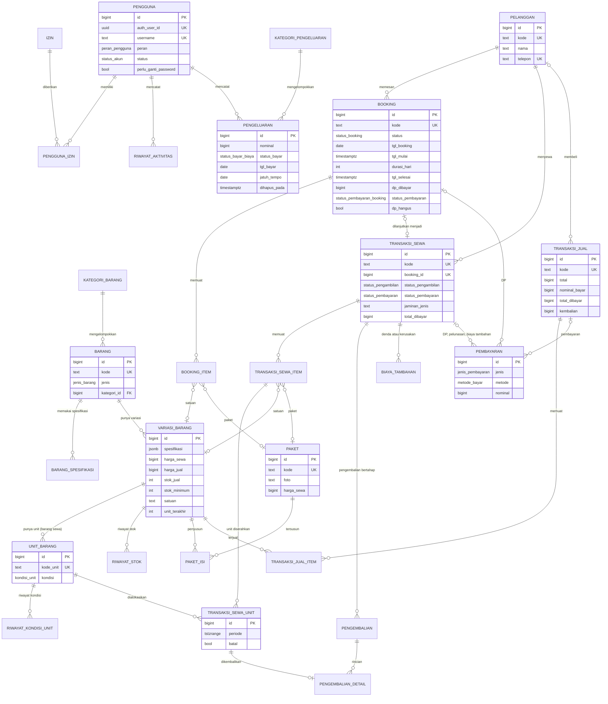

# Desain Database – Summit Rental & Store

## 1. Keputusan DBMS: PostgreSQL 16 (Kompatibel Supabase)

| Kebutuhan sistem | Alasan PostgreSQL cocok |
|---|---|
| Satu unit tidak boleh dialokasikan ke dua penyewaan yang periodenya bertumpang tindih (butir D.15) | `EXCLUDE USING gist (unit_id WITH =, periode WITH &&)` pada tipe `tstzrange` menolak bentrokan langsung di database, juga saat dua Admin menyimpan bersamaan. MySQL tidak punya fitur ini. |
| Transaksi, pembayaran, dan stok harus konsisten | Transaksi ACID penuh, `CHECK`, trigger, dan foreign key. |
| Variasi barang berbeda-beda spesifikasinya (merek, ukuran, kapasitas, spesifikasi lain) | Kolom `jsonb` dengan indeks GIN, tanpa tabel kolom yang melebar. |
| Komposisi dan harga paket harus tetap pada booking atau transaksi lama (butir E.32) | Snapshot `jsonb` pada item booking dan item transaksi. |
| Riwayat aktivitas tidak boleh diubah (butir M.14) | Trigger penolak `UPDATE` dan `DELETE`. |
| Laporan harian dan bulanan (WIB) | `date_trunc`, `AT TIME ZONE 'Asia/Jakarta'`, `FILTER`, window function, dan view. |
| Kode otomatis (BK-0239, TS-0412, TJ-0127, PL-0001, PK-001) | `SEQUENCE` dengan `DEFAULT`. |

Pendukung yang digunakan/disarankan: **Next.js (App Router) + Supabase (PostgreSQL 16, Auth, Storage)** atau Drizzle/Prisma, `pg_dump` terjadwal untuk backup. Ekstensi yang dipakai: `btree_gist` dan `citext`.

Konvensi: uang disimpan sebagai Rupiah utuh (`bigint`), waktu sebagai `timestamptz`, primary key `bigint identity`, nama tabel dan kolom `snake_case` bahasa Indonesia, penghapusan data penting memakai kolom `dihapus_pada` (hapus lunak).

## 2. ERD



## 3. Daftar Tabel

| Kelompok | Tabel | Fungsi |
|---|---|---|
| Sistem | `pengaturan` | DP 25 persen, batas H-2, jam operasional 08.00–21.00 WIB |
| Akses | `pengguna`, `izin`, `pengguna_izin` | Akun Admin/Owner (mendukung tautan `auth_user_id` Supabase & flag `perlu_ganti_password` setelah reset) dan hak akses khusus (5 laporan + pembatalan booking) |
| Audit | `riwayat_aktivitas` | Login, logout, tambah, ubah, hapus, batal, perubahan status/kondisi; data sebelum & sesudah dalam `jsonb`; alasan wajib untuk hapus dan batal; tidak dapat diubah |
| Pelanggan | `pelanggan` | Kode otomatis `PL-xxxx`, nama & telepon wajib (unik agar tidak tercatat ganda), alamat & instansi opsional; tanpa pencatatan nomor KTP/SIM |
| Barang | `kategori_barang`, `barang`, `barang_spesifikasi`, `variasi_barang` | Barang sewa atau jual, spesifikasi bawaan & "spesifikasi lain" (maksimal 3, dijaga trigger), variasi beserta harga, satuan, dan ambang `stok_minimum` |
| Stok | `unit_barang`, `riwayat_kondisi_unit`, `riwayat_stok` | Unit fisik dengan kode unik, enam kondisi, riwayat perubahan kondisi dan mutasi stok (beserta `alasan` penyesuaian) |
| Paket | `paket`, `paket_isi` | Paket (`PKT-xxx`) dan barang penyusunnya (hanya Barang Sewa, dijaga trigger), dilengkapi foto visual fleksibel (unggah berkas atau URL gambar eksternal) |
| Booking | `booking`, `booking_item` | Booking dengan status `draft`, `selesai`, `dibatalkan` (langsung `draft → selesai` tanpa `dikonfirmasi`); menyimpan `tgl_booking`, `tgl_mulai`, `durasi_hari`, `tgl_selesai`, DP wajib & disepakati, `dp_dibayar`, `status_pembayaran`; tanpa input tanggal pengambilan aktual; item satuan/paket dengan snapshot komposisi & harga |
| Penyewaan | `transaksi_sewa`, `transaksi_sewa_item`, `transaksi_sewa_unit` | Transaksi dari booking berstatus `selesai` atau sewa langsung; status pengambilan, pengembalian, dan pembayaran terpisah; `jaminan_jenis` ditulis manual tanpa nomor jaminan; alokasi unit per periode |
| Pengembalian | `pengembalian`, `pengembalian_detail`, `biaya_tambahan` | Pengembalian bertahap, kondisi kembali dan `kondisi_setelah` unit (termasuk penyusun paket), denda dan biaya kerusakan/kehilangan manual dengan alasan wajib |
| Penjualan | `transaksi_jual`, `transaksi_jual_item` | Keranjang penjualan, `nominal_bayar`, `total_dibayar`, `kembalian`, `status_pembayaran` otomatis |
| Pembayaran | `pembayaran` | Satu tabel untuk DP, pelunasan, biaya tambahan, dan penjualan; metode tunai, QRIS, transfer |
| Pengeluaran | `kategori_pengeluaran`, `pengeluaran` | Kategori dikelola Admin & Owner (hapus lunak untuk mendukung urungkan), pengeluaran mendukung `status_bayar`, `tgl_bayar`, `jatuh_tempo`, `lampiran_url`, dan hapus lunak |

Struk/bukti dan laporan tidak punya tabel sendiri. Keduanya dibentuk dari data transaksi, jadi isinya selalu sama dengan data aslinya.

## 4. Aturan Bisnis yang Dijaga Database

| Aturan | Mekanisme |
|---|---|
| Unit tidak boleh dobel pada periode yang bertumpang tindih | `EXCLUDE USING gist (unit_id WITH =, periode WITH &&)` pada `transaksi_sewa_unit` |
| Kode unit unik dan penomoran berlanjut | `unit_barang.kode_unit` unik, `variasi_barang.unit_terakhir` |
| Variasi ganda ditolak | `UNIQUE (barang_id, spesifikasi)` |
| Spesifikasi lain maksimal 3 | Trigger `batasi_spesifikasi_lain` |
| Hanya Barang Sewa masuk paket | Trigger `hanya_barang_sewa` |
| Item booking atau transaksi: barang satuan atau paket, tidak keduanya | `CHECK ck_*_item_tipe` |
| Tanggal mulai sewa booking tidak lebih awal dari tanggal booking | `CHECK ck_booking_tgl_mulai` |
| Satu booking hanya menjadi satu transaksi & hanya status `selesai` yang boleh dilanjutkan | `transaksi_sewa.booking_id` unik + trigger `cek_booking_untuk_sewa` |
| DP booking otomatis terhubung ke transaksi sewa tanpa dicatat ulang | Trigger `trg_sewa_tautkan_dp` menautkan baris `pembayaran` booking ke `sewa_id` dan menghitung ulang total |
| Status pembayaran otomatis di `booking`, `transaksi_sewa`, dan `transaksi_jual` | Trigger `trg_pembayaran_sync_aiud` dan `trg_biaya_tambahan_aiud` (insert/update/delete) |
| Pembatalan wajib berpenyebab & berpelaku, hapus hanya untuk Draft ber-alasan | `CHECK ck_booking_batal`, `ck_booking_hapus` pada `booking` & `ck_alasan_hapus` pada `riwayat_aktivitas` |
| DP hangus dipisahkan sebagai penerimaan non-sewa tanpa dihitung ganda | View `v_penerimaan` memberi label `sumber = 'dp_hangus'` untuk pembayaran milik booking `dibatalkan` |
| Pembayaran harus terkait tepat satu jenis induk | `CHECK ck_pembayaran_induk`, `ck_pembayaran_jenis` |
| Riwayat tidak dapat diubah atau dihapus | Trigger `tolak_ubah_riwayat` |
| Stok jual dan stok minimum tidak boleh negatif | `CHECK (stok_jual >= 0)`, `CHECK (stok_minimum >= 0)` |

Aturan yang dijalankan di aplikasi (karena tergantung konteks atau waktu):
- DP wajib untuk booking H-2 atau lebih, tanpa DP untuk H-1/Hari-H, dengan nilai dari `pengaturan`.
- Pembatalan booking karena pelanggan tidak hadir/mengambil barang hingga batas jam operasional toko (`jam_tutup`, default 21.00 WIB) pada hari mulai sewa dicatat sebagai `dibatalkan` (alasan no-show) dengan DP non-refundable.
- Pengembalian setelah pukul 21.00 WIB atau lewat tanggal kembali dianggap terlambat.
- Unit baru menjadi `tersedia` hanya setelah diperiksa dan dinyatakan siap secara manual oleh Admin.
- Hanya Owner atau pengguna dengan `izin` khusus yang membuka Laporan atau membatalkan booking.

## 5. View dan Fungsi

| Objek | Kegunaan |
|---|---|
| `v_stok_variasi` | Ringkasan per Variasi (barang aktif): total, tersedia, disewa, dicuci, persiapan, rusak, perawatan |
| `v_monitoring_sewa` | Tracking masa sewa & monitoring penyewaan (`Belum Diambil`, `Sedang Disewa`, `Menunggu Pengembalian`, `Terlambat`, `Selesai`, `Batal`), `sisa_hari`, `mendekati_jatuh_tempo` (H-1/Hari-H), `hari_terlambat`, dan `sisa_tagihan` |
| `v_penerimaan` | Uang diterima per tanggal (WIB), jenis, metode, dan `sumber` (`sewa`, `booking`, `jual`, `dp_hangus`). Dasar Laporan Keuangan (kas riil terpisah dari tagihan & DP hangus terpisah dari omzet sewa) |
| `ketersediaan_variasi(variasi, mulai, selesai, abaikan_booking)` | Jumlah tersedia pada periode: unit operasional (bukan `rusak`/`perawatan`), dikurangi booking `selesai` yang bertumpuk (satuan & isi paket, bila belum menjadi transaksi sewa aktif), dikurangi unit yang sedang dialokasikan pada transaksi sewa aktif |
| `ketersediaan_paket(paket, mulai, selesai, abaikan_booking)` | Ketersediaan paket dihitung dari nilai terkecil `ketersediaan_variasi / jumlah` seluruh variasi penyusunnya |

## 6. Contoh Query Laporan

```sql
-- Laporan Keuangan bulanan: diterima, pengeluaran (dibayar), selisih
SELECT
  (SELECT COALESCE(sum(nominal),0) FROM v_penerimaan
    WHERE tanggal BETWEEN :mulai AND :selesai) AS diterima,
  (SELECT COALESCE(sum(nominal),0) FROM pengeluaran
    WHERE dihapus_pada IS NULL AND status_bayar = 'sudah_dibayar'
      AND tanggal BETWEEN :mulai AND :selesai) AS pengeluaran_dibayar;

-- Belum diterima (tagihan dikurangi pembayaran)
SELECT COALESCE(sum(total_sewa + total_biaya_tambahan - total_dibayar),0)
FROM transaksi_sewa WHERE status <> 'batal' AND (tgl_mulai AT TIME ZONE 'Asia/Jakarta')::date BETWEEN :mulai AND :selesai;

-- Laporan harian: kelompokkan per hari (untuk periode Bulanan tampil per tanggal)
SELECT tanggal, sum(nominal) FROM v_penerimaan
WHERE tanggal BETWEEN :mulai AND :selesai GROUP BY tanggal ORDER BY tanggal;

-- Barang paling sering disewa
SELECT nama_snapshot, count(*) AS kali, sum(subtotal) AS pendapatan
FROM transaksi_sewa_item i JOIN transaksi_sewa t ON t.id = i.sewa_id
WHERE t.status <> 'batal' AND (t.tgl_mulai AT TIME ZONE 'Asia/Jakarta')::date BETWEEN :mulai AND :selesai
GROUP BY nama_snapshot ORDER BY kali DESC;
```

## 7. Catatan dan Batasan
- `schema.sql` kompatibel dengan `Seed_Data_Paket_Summit.md` dan dapat langsung dijadikan migrasi awal (`supabase/migrations/0001_init.sql`).
- Kebijakan RLS (Row Level Security) dan fungsi RPC atomik untuk operasi multi-tabel (sewa/pelunasan/pengembalian/penjualan) disiapkan pada migrasi lanjutan sesuai `ATURAN-STRUKTUR-PROJECT.md`.
- Pembaruan stok jual saat penjualan, serta perpindahan kondisi unit saat pengambilan atau pengembalian, dijalankan aplikasi/RPC dalam satu transaksi database bersama pencatatan `riwayat_stok` / `riwayat_kondisi_unit` dan `riwayat_aktivitas`.
